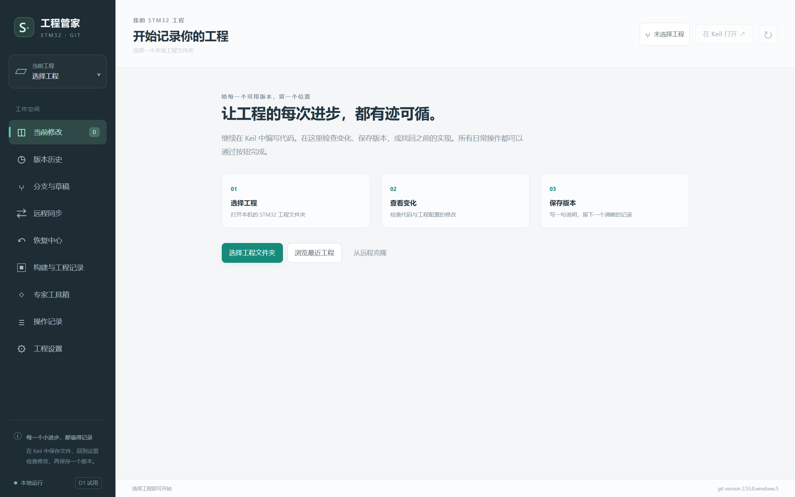

# STM32 Git 工程管家

面向 STM32 / Keil 新手的中文桌面工具，用按钮完成版本保存、查看历史、分支协作与 GitHub 同步，并把 Keil 编译、固件和工程笔记关联起来。

**当前版本：v0.4.1，Windows x64 公开试用版。** 首次启动不预选工程，也不包含任何个人工程或历史数据。

**[下载 Windows 免安装版](https://github.com/1300282202/stm32-git-manager/releases/tag/v0.4.1)** · [五分钟上手](docs/QUICKSTART.md) · [完整使用说明](docs/USER-GUIDE.md) · [常见问题](docs/FAQ.md)

## 直接使用

1. 从上方下载页下载 `STM32Git-v0.4.1-win32-x64.zip`，**解压整个压缩包**。
2. 电脑安装 [Git for Windows](https://git-scm.com/download/win)。编译功能另需自行安装 Keil MDK 和工程对应的编译器、设备支持包。
3. 双击解压目录中的 `STM32Git.exe`，选择包含 Keil 工程和源码的工程根目录。
4. 在 Keil 保存文件，回工具查看修改，勾选文件、填写说明，再“预览并保存版本”。

免安装版无需 Node.js。不要只复制 EXE；旁边的运行库、`resources` 等目录也需要保留。Windows 发行包尚未做代码签名。

## 可以做什么

| 工作 | 当前支持 |
| --- | --- |
| 日常版本管理 | 工程初始化、忽略规则预览、修改对比、暂存、提交、版本历史、备份后恢复单文件 |
| 分支协作 | 创建/切换/合并分支、冲突处理、临时草稿、普通提交移植、标签、独立工作目录、源码 ZIP |
| GitHub | 通过系统凭据助手登录、关联已有仓库、获取、快进拉取、普通推送、打开仓库网页 |
| 专家工具 | 重置/清理预览与操作前备份、救援分支、reflog、手动二分、只读诊断、离线历史包导出与验证 |
| Keil 工程 | `.uvprojx` Target 识别、隔离快照编译、日志、产物哈希、手工上板结果记录、固件来源归档 |
| 工程记录 | 基础 Markdown 编辑/预览、本地图片、手动检查点、可选自动检查点、规则提交说明草稿 |

它覆盖日常流程和一部分高级流程。**不是 Git 所有命令的完整图形化实现。** 完整交互式变基、子模块、稀疏检出、签名、LFS 读写迁移、在线 AI、自动烧录等仍未实现。详见 [功能范围与后续计划](docs/FEATURES.md)。



上图为首次启动入口。[工程笔记预览](docs/images/notes.png) 和 [构建记录预览](docs/images/build-simulation.png) 来自隔离示例工程。界面自动测试中的编译器为模拟构建器；模拟产物不表示真实固件或硬件验证通过。此前本机 Keil 5.18 / ARMCC 5.06 已完成独立真实工程编译验证，结果和验证边界见 [测试说明](docs/TESTING.md)。

## 数据在哪里

正式 Git 历史位于你所选工程自己的 `.git`。应用设置、恢复备份、构建记录和检查点默认放在程序旁的 `data/`，不自动上传。**升级前先备份这个目录。** 下载包不附带任何用户数据。

GitHub 登录交给 Git for Windows 的 Git Credential Manager；不要把密码或令牌写进仓库地址。只有你明确执行推送等远程操作时，才会上传所选仓库的提交。编译通过和上板验证分别记录，工具不自动烧录。

## 从源码运行

开发环境：Windows x64、Node.js 24+、Git。依赖版本已锁定。

```powershell
git clone https://github.com/1300282202/stm32-git-manager.git
cd stm32-git-manager
npm ci
npm run check
npm test
npm start
```

若 Electron 下载未完成，按 [开发说明](docs/DEVELOPMENT.md) 排查。生成免安装包：

```powershell
npm run package
npm run package:zip
```

## 文档导航

- [五分钟上手](docs/QUICKSTART.md)：第一次保存版本与连接 GitHub。
- [使用说明](docs/USER-GUIDE.md)：日常、协作、专家与工程扩展功能。
- [常见问题](docs/FAQ.md)：编译、授权、恢复、编码和升级。
- [功能范围](docs/FEATURES.md)：已交付能力、限制与后续计划。
- [开发说明](docs/DEVELOPMENT.md) / [接口约定](docs/API.md) / [测试说明](docs/TESTING.md)。
- [更新记录](CHANGELOG.md) / [贡献方式](CONTRIBUTING.md) / [隐私与安全说明](SECURITY.md)。

## 反馈与许可

通过 [GitHub Issues](https://github.com/1300282202/stm32-git-manager/issues) 提交问题，建议包含程序版本、Windows/Git/Keil 版本、复现步骤和去除私密内容的日志。

工具源码使用 [MIT 许可证](LICENSE)。Electron、Chromium 和其他第三方组件遵循各自许可证，见 [第三方说明](THIRD-PARTY-NOTICES.md)。Keil、Git、STM32 SDK 与设备包不随本项目分发。

